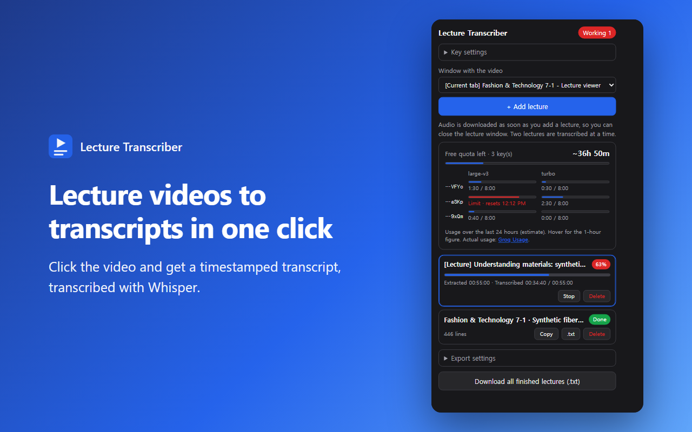
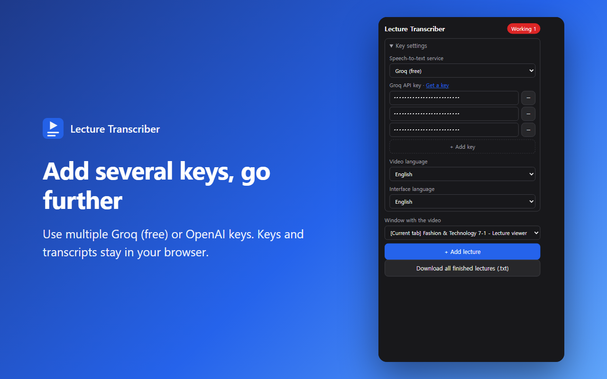
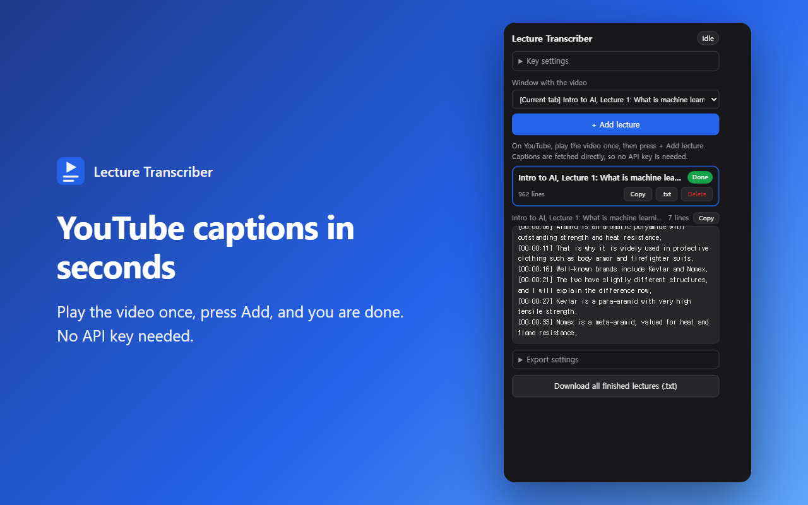
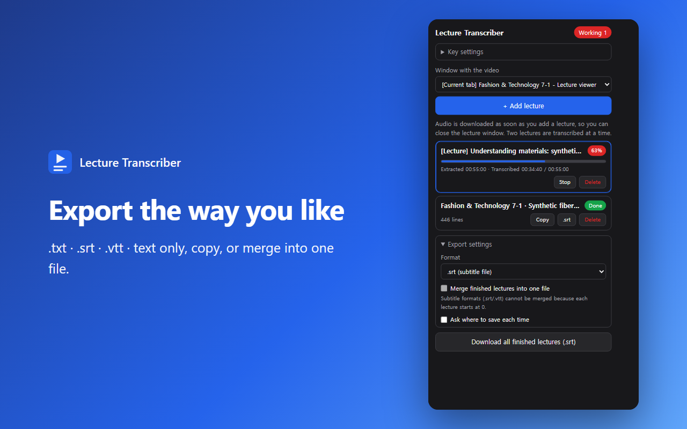

<div align="center">


# Lecture Transcriber

**Turn lecture videos into timestamped transcripts (.txt · .srt · .vtt).**
Click the video once. On YouTube, it grabs the existing captions instantly.

[한국어](README.md) · **English**

</div>

<p align="center">
  
</p>

> Screenshots are the real popup UI rendered with demo data.

## Features

- **One click** — click the video on a lecture page and the extension downloads the source (HLS `.m3u8` or `.mp4`), extracts only the audio and transcribes it with Whisper. The video does **not** need to play.
- **YouTube support** — for YouTube it fetches the video's existing captions (manual or auto-generated). It finishes in seconds and needs no API key.
- **Many lectures at once** — audio is downloaded as soon as you add a lecture, so you can close the lecture window right away. Transcription runs in the order added.
- **Export** — `.txt` (timestamps), `.txt` (text only), `.srt`, `.vtt`, copy to clipboard, merge finished lectures into one named file, optional "ask where to save".
- **Free to start** — [Groq](https://console.groq.com/keys)'s free tier covers roughly 16 hours of audio per day. You can add several keys.
- **Korean · English** — switch the interface language in settings.
- **Your data stays in your browser** — API keys and transcripts are stored in `chrome.storage.local` only. See the [Privacy Policy](docs/PRIVACY.md).

## Install

### Chrome Web Store
Coming soon.

### Manual install (developer mode)

1. **[⬇️ Download lecture-transcriber.zip](https://github.com/efforthye/chrome_lecture_transcriber/releases/latest/download/lecture-transcriber.zip)** and unzip it. (If you cloned the repo, use the `extension` folder.)
2. Open `chrome://extensions` and turn on **Developer mode** (top right).
3. Click **Load unpacked** and select the folder that contains `manifest.json`.
4. Pin **Lecture Transcriber** from the puzzle-piece menu for quick access.

To update, unzip the new release over the same folder and press ↻ on `chrome://extensions`. Your API keys and transcripts are kept. Requires Chrome 116 or later.

## How to use

### 1. Add an API key (once; skip this if you only use YouTube)

Open the extension → **Key settings**, choose a provider and paste your key.

| Provider | Get a key | Cost |
|---|---|---|
| **Groq** (default) | https://console.groq.com/keys → Create API Key (`gsk_...`) | Free within limits, no card needed |
| OpenAI | https://platform.openai.com/api-keys (`sk-...`) + a payment method | $0.006 per audio minute |

With Groq the extension uses `whisper-large-v3` first and falls back to `whisper-large-v3-turbo` when the free limit is hit. Limits are tracked per model (about 2 hours of audio per hour and 8 hours per day each), so roughly 16 hours a day are free. If both are exhausted it waits and resumes automatically. Check exact limits on [Groq's limits page](https://console.groq.com/settings/limits).

You can add several keys with **+ Add key**; invalid keys are skipped. Keys from the same account share one limit. Pooling several accounts to exceed a limit may violate Groq's terms.

<p align="center">
  
</p>

Change the **interface language** under **Key settings → Interface language** (Korean / English). The default follows your browser language.

### 2. Regular lecture sites (HLS / mp4)

1. Open the lecture page, open the extension, pick that window under **Window with the video** and press **+ Add lecture**.
2. When the lecture window comes to the front, click the blue box over the video. (Esc to cancel.)
3. The audio is downloaded right away, so you can **close the lecture window**. Open the next one and keep adding.

From the lecture page itself you can also use `Alt+Shift+S` or right-click → "Create transcript for this page's video".

### 3. YouTube

<p align="center">
  
</p>

1. Open a YouTube video page (`youtube.com/watch?v=...`).
2. **Click the video once (play it)** so YouTube loads its captions.
3. Open the extension and press **+ Add lecture**. No need to click a blue box.

It is added to the list within seconds. This uses the captions YouTube already has instead of transcribing audio, so **videos without captions are not supported**. Auto-generated captions are less accurate than Whisper, especially for names and numbers. If it fails, you get a specific reason (no captions, live stream, unavailable video…), and temporary blocks are retried once automatically.

### 4. Export

<p align="center">
  
</p>

Every lecture has **Copy** and **download** buttons, and **Export settings** lets you choose:

| Format | Description |
|---|---|
| `.txt` (timestamps) | `[00:01:23] sentence`, the default |
| `.txt` (text only) | Sentences without timestamps |
| `.srt` / `.vtt` | Subtitle files for video players and editors |

Turn on **merge finished lectures into one file** to download everything as a single file with a name you choose. (`.srt`/`.vtt` cannot be merged because each lecture's timestamps start at 0.) Turn on **ask where to save** to get a Save dialog every time.

Example output:

```
Fashion & Technology 7-1
https://cn2.hongik.ac.kr/mod/vod/viewer.php?id=1094013

[00:00:03] Today is the second session on synthetic fibers, starting with aramid fibers.
[00:00:11] ...
```

## How it works

1. Finds the source URL of the clicked `<video>`. If `src` is a `blob:` URL (hls.js etc.), it looks in the page's network history and HTML for the `.m3u8`.
2. Downloads the source in an offscreen document.
   - HLS: picks the lowest-quality (or audio-only) rendition, downloads segments in parallel, decrypts AES-128 and extracts the audio from MPEG-TS.
   - mp4: downloads the whole file.
3. Decodes to 16 kHz mono and splits into ~5 minute chunks, cutting at the quietest point near each boundary so sentences are not split.
4. Sends each chunk to the Whisper API and adds the chunk's start time to produce video-based timestamps. Downloading and transcribing run concurrently.

**YouTube** has no `.m3u8`, and its audio URLs need signatures and PO Tokens, so the steps above cannot be used. The extension looks for captions instead, in this order:

1. The `timedtext` URL of the player's `captionTracks`
2. Briefly turning captions on and re-fetching the `timedtext` request the player itself sends (it carries the PO Token)
3. If both are blocked, opening the "Show transcript" panel and reading its text and times

## Notes

- If the video URL isn't found, play the video once and try again (the player has to request the playlist first).
- DRM-protected videos (Widevine etc.) can't be downloaded.
- mp4 sources are loaded into memory whole, so very large files (over ~1 GB) may be slow or fail.
- API keys and transcripts live only in `chrome.storage.local`; audio goes only to the speech-to-text API you chose. See the [Privacy Policy](docs/PRIVACY.md).
- Use lecture videos and transcripts for personal study only. You are responsible for respecting the terms of service and copyright of the sites you use.

## Docs

- [Privacy Policy](docs/PRIVACY.md) · [개인정보처리방침](docs/PRIVACY.ko.md)
- [Chrome Web Store listing material](docs/STORE_LISTING.md) (descriptions, permission justifications, images)

## License

See [LICENSE](LICENSE).
