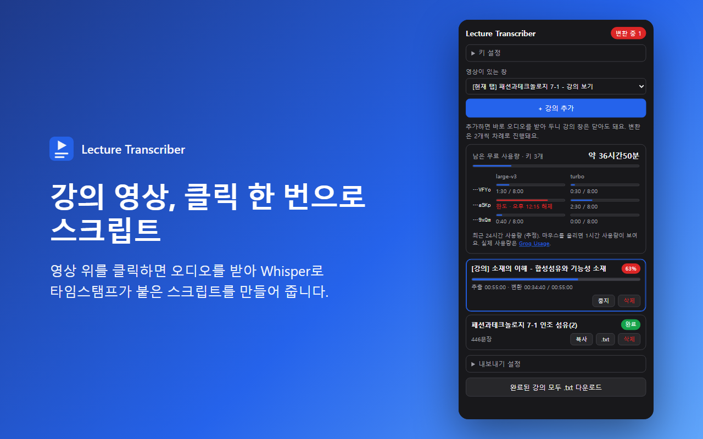
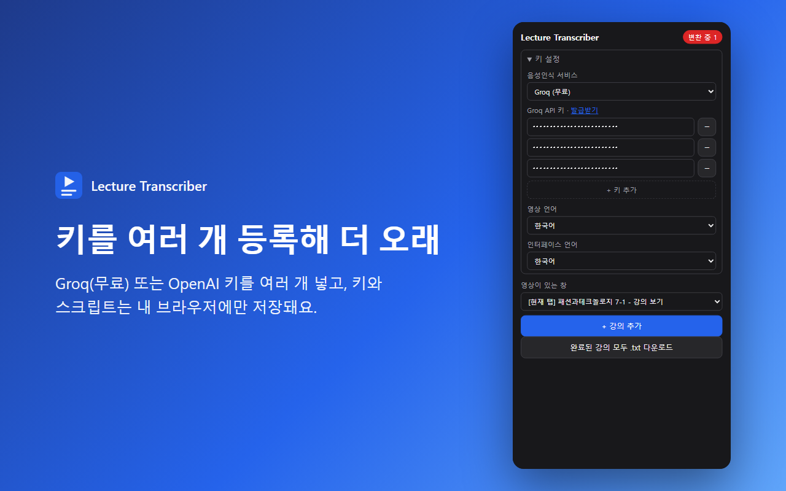
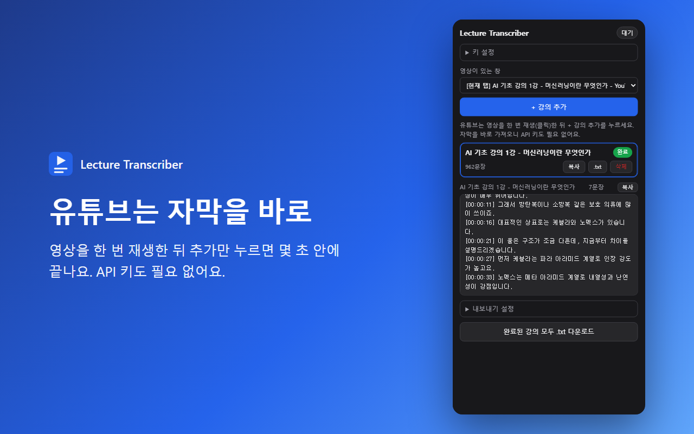
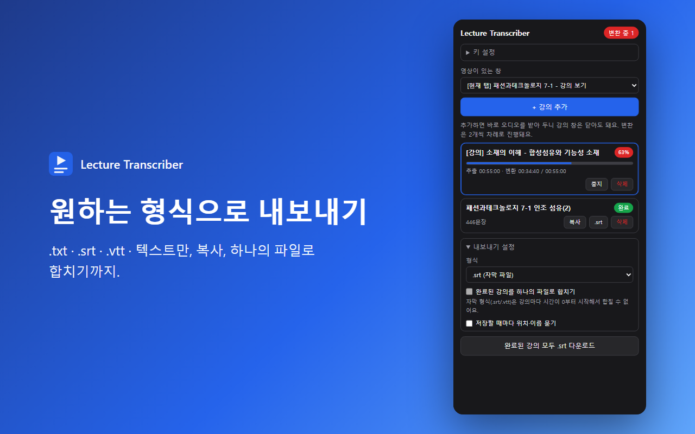

<div align="center">


# Lecture Transcriber

**강의 영상을 타임스탬프가 붙은 스크립트(.txt · .srt · .vtt)로.**
영상 위를 한 번 클릭하면 끝. 유튜브는 자막을 바로 가져옵니다.

**한국어** · [English](README.en.md)

</div>

<p align="center">
  
</p>

> 스크린샷은 데모 데이터로 실제 팝업 화면을 렌더링한 것입니다.

## 특징

- **클릭 한 번** — 강의 창에서 영상을 클릭하면 원본(HLS `.m3u8`·`.mp4`)을 직접 받아 오디오만 뽑아 Whisper로 변환합니다. **영상을 재생하지 않아도** 처음부터 끝까지 변환됩니다.
- **유튜브 지원** — 유튜브 영상은 이미 있는 자막(수동·자동 생성)을 가져와 몇 초 만에 끝나고, API 키도 필요 없습니다.
- **여러 강의를 한꺼번에** — 추가하는 즉시 오디오를 받아 두므로 강의 창은 바로 닫아도 됩니다. 변환은 먼저 추가한 순서로 진행됩니다.
- **내보내기** — `.txt`(타임스탬프) · `.txt`(텍스트만) · `.srt` · `.vtt`, 클립보드 복사, 완료된 강의를 하나의 파일로 합치기(파일 이름 지정), 저장 위치 묻기.
- **무료로 시작** — [Groq](https://console.groq.com/keys) 무료 한도로 하루 약 16시간 분량을 변환할 수 있습니다. 키를 여러 개 넣을 수도 있습니다.
- **한국어 · English** — 인터페이스 언어를 설정에서 바꿀 수 있습니다.
- **내 데이터는 내 브라우저에** — API 키와 스크립트는 `chrome.storage.local`에만 저장됩니다. 자세한 내용은 [개인정보처리방침](docs/PRIVACY.ko.md).

## 설치

### Chrome 웹 스토어
등록 준비 중입니다.

### 직접 설치 (개발자 모드)

1. **[⬇️ lecture-transcriber.zip 다운로드](https://github.com/efforthye/chrome_lecture_transcriber/releases/latest/download/lecture-transcriber.zip)** 후 압축을 풉니다. (저장소를 받았다면 `extension` 폴더를 쓰면 됩니다.)
2. Chrome에서 `chrome://extensions` 를 열고 오른쪽 위 **개발자 모드**를 켭니다.
3. **압축해제된 확장 프로그램을 로드합니다** → 압축을 푼 폴더(`manifest.json`이 들어 있는 폴더)를 선택합니다.
4. 툴바의 퍼즐 아이콘에서 **Lecture Transcriber**를 고정해 두면 편합니다.

업데이트: 새 zip을 받아 같은 폴더에 덮어쓰고 `chrome://extensions`에서 ↻(새로고침)을 누르세요. API 키와 스크립트는 그대로 남습니다. Chrome 116 이상이 필요합니다.

## 사용법

### 1. API 키 넣기 (처음 한 번, 유튜브만 쓸 거면 건너뛰어도 됩니다)

확장 아이콘 → **키 설정**에서 서비스를 고르고 키를 넣습니다.

| 서비스 | 발급 | 비용 |
|---|---|---|
| **Groq** (기본값) | https://console.groq.com/keys → Create API Key (`gsk_...`) | 무료 한도 내 무료 (카드 등록 불필요) |
| OpenAI | https://platform.openai.com/api-keys (`sk-...`) + 결제 수단 등록 | 오디오 1분당 $0.006 |

Groq은 `whisper-large-v3`를 먼저 쓰고, 무료 한도에 걸리면 `whisper-large-v3-turbo`로 자동으로 넘어갑니다. 무료 한도는 모델마다 따로 잡혀서(각각 1시간에 오디오 약 2시간, 하루 약 8시간) 하루 약 16시간까지 무료로 변환할 수 있습니다. 두 모델이 모두 한도에 걸리면 풀릴 때까지 기다렸다가 이어서 변환합니다. 정확한 한도는 [Groq 한도 페이지](https://console.groq.com/settings/limits)에서 확인하세요.

키는 **+ 키 추가**로 여러 개 넣을 수 있고, 유효하지 않은 키는 건너뜁니다. 같은 계정에서 만든 키는 한도를 공유하므로 늘어나지 않습니다. 여러 계정의 사용량을 합쳐 한도를 넘기는 것은 Groq 이용 정책에 어긋날 수 있으니 주의하세요.

<p align="center">
  
</p>

**인터페이스 언어**는 **키 설정 → 인터페이스 언어**에서 한국어 / English로 바꿀 수 있습니다. (기본값은 브라우저 언어를 따릅니다.)

### 2. 일반 강의 사이트 (HLS / mp4)

1. 강의 창을 열고 확장 아이콘 → **영상이 있는 창**에서 그 창을 고른 뒤 **+ 강의 추가**.
2. 강의 창으로 전환되면 영상 위 파란 박스를 클릭합니다. (Esc로 취소)
3. 목록에 추가되는 즉시 오디오를 받아 두므로 **강의 창은 바로 닫아도 됩니다.** 다음 강의 창을 열어 계속 추가하세요.

강의 창에서 바로 추가하려면 `Alt+Shift+S` 또는 우클릭 → "이 페이지 영상 스크립트 만들기".

### 3. 유튜브

<p align="center">
  
</p>

1. 유튜브 영상 페이지(`youtube.com/watch?v=...`)를 엽니다.
2. **영상을 한 번 클릭(재생)** 합니다. 그래야 유튜브가 자막을 불러옵니다.
3. 확장 아이콘 → **+ 강의 추가**. 파란 박스를 클릭할 필요는 없습니다.

몇 초 안에 목록에 추가됩니다. 오디오를 변환하는 것이 아니라 유튜브에 이미 있는 자막을 가져오는 방식이라 **자막이 없는 영상은 지원하지 않습니다.** 자동 생성 자막은 Whisper보다 정확도가 낮아서 고유명사·숫자에서 오인식이 있을 수 있습니다. 실패하면 원인(자막 없음, 라이브, 재생 불가 등)을 안내하고, 일시적으로 막힌 경우에는 한 번 자동으로 다시 시도합니다.

### 4. 내보내기

<p align="center">
  
</p>

강의마다 **복사**와 **파일 다운로드** 버튼이 있고, **내보내기 설정**에서 다음을 고를 수 있습니다.

| 형식 | 설명 |
|---|---|
| `.txt` (타임스탬프) | `[00:01:23] 문장` 형태. 기본값 |
| `.txt` (텍스트만) | 타임스탬프 없이 문장만 |
| `.srt` / `.vtt` | 동영상 플레이어·편집기에서 쓰는 자막 파일 |

**완료된 강의를 하나의 파일로 합치기**를 켜면 완료된 강의를 파일 하나로 받고 파일 이름을 직접 정할 수 있습니다. (`.srt`/`.vtt`는 강의마다 시간이 0부터 시작해서 합칠 수 없습니다.) **저장할 때마다 위치·이름 묻기**를 켜면 매번 저장 대화상자가 뜹니다.

결과 예시:

```
패션과테크놀로지 7-1
https://cn2.hongik.ac.kr/mod/vod/viewer.php?id=1094013

[00:00:03] 오늘은 인조 섬유 두 번째 시간으로 아라미드 섬유부터 살펴보겠습니다.
[00:00:11] ...
```

## 동작 방식

1. 클릭한 `<video>`의 원본 주소를 찾습니다. `src`가 `blob:`(hls.js 등)이면 페이지가 받아간 `.m3u8` 기록이나 HTML에서 찾습니다.
2. 오프스크린 문서에서 원본을 내려받습니다.
   - HLS: 가장 낮은 화질(또는 오디오 전용) 트랙을 골라 세그먼트를 병렬로 받고, AES-128 암호화를 풀고, MPEG-TS에서 오디오만 뽑습니다.
   - mp4: 파일 전체를 받습니다.
3. 16kHz 모노로 디코딩해 약 5분 단위로 자릅니다. 문장이 잘리지 않도록 경계 근처에서 가장 조용한 지점을 고릅니다.
4. 조각마다 Whisper API로 보내고, 조각 시작 시간을 더해 영상 기준 타임스탬프를 만듭니다. 다운로드와 변환은 동시에 진행됩니다.

**유튜브**는 `.m3u8`이 없고 오디오 주소에 서명·PO Token이 필요해서 위 방식을 쓸 수 없습니다. 대신 다음 순서로 자막을 찾습니다.

1. 플레이어가 가진 자막 트랙(`captionTracks`)의 `timedtext` 주소로 받기
2. 자막을 잠깐 켜서 플레이어가 직접 보내는 `timedtext` 요청(PO Token 포함)을 다시 받기
3. 위가 막히면 "스크립트 표시" 패널을 열어 텍스트와 시간을 읽기

## 주의

- 영상 주소를 못 찾으면 영상을 한 번 재생했다가 다시 시도하세요. (플레이어가 재생목록을 받아가야 주소가 남습니다.)
- DRM(Widevine 등)이 걸린 영상은 받을 수 없습니다.
- mp4 원본은 전체를 메모리에 올리므로 아주 긴 영상(1GB 이상)은 느리거나 실패할 수 있습니다.
- API 키와 스크립트는 브라우저의 `chrome.storage.local`에만 저장되고, 오디오는 선택한 음성인식 API로만 전송됩니다. 자세한 내용은 [개인정보처리방침](docs/PRIVACY.ko.md)을 보세요.
- 강의 영상과 스크립트는 개인 학습 용도로만 사용하세요. 서비스 약관과 저작권을 지킬 책임은 사용자에게 있습니다.

## 문서

- [개인정보처리방침](docs/PRIVACY.ko.md) · [Privacy Policy](docs/PRIVACY.md)
- [Chrome 웹 스토어 등록 자료](docs/STORE_LISTING.md) (설명문, 권한 사유, 이미지)

## 라이선스

[LICENSE](LICENSE)를 참고하세요.
